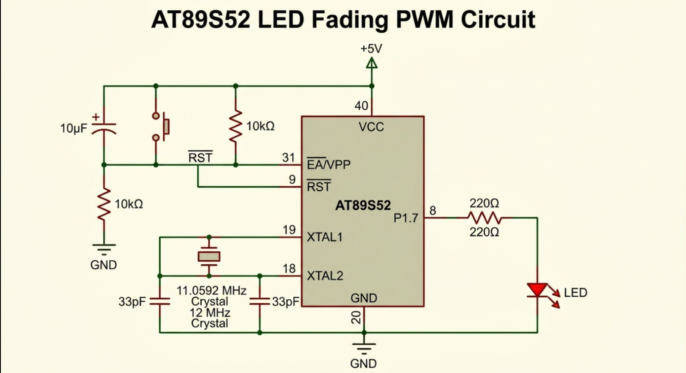

# EXPERIMENT DETAILS

**EXP:** CONTINUOUS LAB EVALUATION 5 – TIMER-BASED LED CONTROL

**DATE:** 10-08-2026

**NAME OF EXP:** Timer-Based LED Control Using Hardware Timer Interrupt

**HARDWARE SETUP / PLATFORM:** Keil µVision + AT89S52 Development Board + 11.0592 MHz Crystal

---

## TASK 1 – Timer0 Interrupt-Based LED Toggle

### 1. Circuit Diagram

The experiment uses the AT89S52 microcontroller to control an LED connected to Port 1, Pin 7 (P1.7). Timer0 generates periodic interrupts to toggle the LED at one-second intervals.

**Hardware Components and Connections:**

- **Development Board:** AT89S52 8051 Development Board
- **Microcontroller IC:** AT89S52
- **CPU Core:** 8051
- **Operating Voltage:** +5 V
- **Crystal Oscillator:** 11.0592 MHz
- **Crystal Pins:** XTAL1 (Pin 19) and XTAL2 (Pin 18)
- **LED GPIO Port:** Port 1
- **LED GPIO Pin:** P1.7 (Pin 8)
- **LED Connection:** P1.7 through a 330 Ω current-limiting resistor and LED to GND.
- **Reset Pin:** RST (Pin 9)
- **Power Supply:** +5 V and GND

**Circuit Diagram:**

### 2. Core Logic / Pseudocode / Code Base

**Working Principle:**

This experiment demonstrates hardware timer-based interrupt generation using the Timer0 peripheral of the AT89S52 microcontroller.

Timer0 is configured in Mode 1 (16-bit timer mode). The timer is loaded with the initial values `TH0 = 0xFC` and `TL0 = 0x66`, producing an approximately 1 ms timer overflow interval for an 11.0592 MHz crystal.

Whenever Timer0 overflows, an interrupt is generated. The Timer0 interrupt service routine reloads the timer and increments a millisecond counter.

After 1000 interrupts, the counter resets and the LED connected to P1.7 is toggled. This produces an LED state change approximately every one second.

**Pseudocode:**

1. Initialize the LED pin.
2. Configure Timer0 in 16-bit Mode 1.
3. Load the timer registers with the initial values.
4. Enable the Timer0 interrupt.
5. Enable global interrupts.
6. Start Timer0.
7. Whenever Timer0 overflows:
   - Reload TH0 and TL0.
   - Increment the millisecond counter.
   - If the counter reaches 1000:
     - Reset the counter.
     - Toggle the LED.
8. Repeat continuously.

**Code Base:**

The implementation uses the following 8051 register-level features:

- `TMOD` – Configures Timer0 in Mode 1.
- `TH0` and `TL0` – Store the timer's initial count values.
- `ET0` – Enables the Timer0 interrupt.
- `EA` – Enables global interrupts.
- `TR0` – Starts Timer0.
- `interrupt 1` – Defines the Timer0 interrupt service routine.
- `P1.7` – Controls the LED.

A custom delay function is not required because the hardware timer generates the periodic interrupts.

### 3. INFERENCE

The experiment successfully demonstrates the use of Timer0 in 16-bit mode to generate periodic hardware interrupts. By maintaining a software time base inside the interrupt service routine, the LED connected to P1.7 toggles at approximately one-second intervals.

This demonstrates hardware timer configuration, interrupt handling, direct register access and time-based LED control without using software delay loops.
