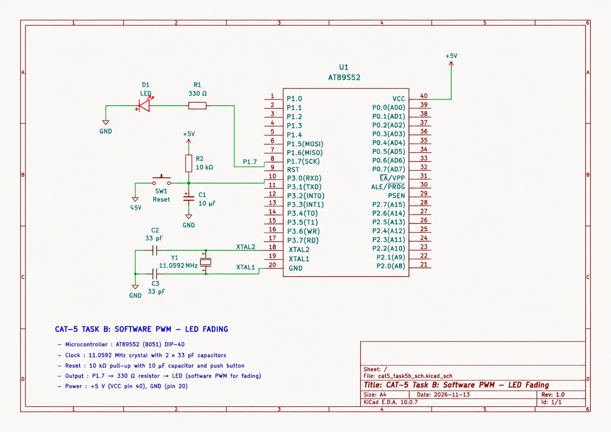

# EXPERIMENT DETAILS

**EXP:** CONTINUOUS LAB EVALUATION 5– TIMER-BASED LED CONTROL

**DATE:** 10/08/2026

**NAME OF EXP:** Timer-Based LED Brightness Control Using Software PWM

**HARDWARE SETUP / PLATFORM:** Keil µVision + AT89S52 Development Board + 11.0592 MHz Crystal

---

## TASK 2A – LED Fading Using Software PWM

### 1. Circuit Diagram

The experiment uses the AT89S52 microcontroller to control the brightness of an LED using software-generated Pulse Width Modulation (PWM).

**Hardware Components and Connections:**

- **Development Board:** AT89S52 8051 Development Board
- **Microcontroller IC:** AT89S52
- **CPU Core:** 8051
- **Operating Voltage:** +5 V
- **Crystal Oscillator:** 11.0592 MHz
- **Crystal Pins:** XTAL1 (Pin 19) and XTAL2 (Pin 18)
- **LED GPIO Port:** Port 1
- **LED GPIO Pin:** P1.7 (Pin 8)
- **LED Connection:** P1.7 connected through a 330 Ω current-limiting resistor and LED to GND.
- **Power Supply:** +5 V and GND

**Circuit Diagram:**

### 2. Core Logic / Pseudocode / Code Base

**Working Principle:**

This experiment demonstrates LED brightness control using software-generated Pulse Width Modulation (PWM) with the Timer0 interrupt of the AT89S52 microcontroller.

Timer0 is configured in Mode 2 (8-bit auto-reload mode). The timer generates periodic interrupts, and each interrupt updates the PWM tick counter.

The PWM period is divided into 20 steps. The LED is switched ON when the current tick is less than the duty-cycle value and switched OFF for the remaining ticks.

The duty cycle is gradually increased from 0 to 100% and then decreased back to 0%. This produces a continuous LED fading effect.

A separate period counter determines when the duty cycle should be changed. The interrupt service routine sets a flag, and the main program updates the duty cycle using this flag.

**Pseudocode:**

1. Initialize the LED as OFF.
2. Configure Timer0 in Mode 2 (8-bit auto-reload mode).
3. Load TH0 and TL0 with the initial timer value.
4. Enable Timer0 and global interrupts.
5. Start Timer0.
6. In the Timer0 interrupt service routine:
   - Increment the PWM tick counter.
   - Reset the tick counter after 20 steps.
   - Increment the PWM period counter.
   - Set the fade flag after the specified number of PWM periods.
   - Compare the current tick with the duty-cycle value.
   - Switch the LED ON or OFF accordingly.
7. In the main loop:
   - Check the fade flag.
   - Increase the duty cycle until it reaches 100%.
   - Decrease the duty cycle until it reaches 0%.
   - Repeat the fading process continuously.

**Code Base:**

The implementation uses the following 8051 registers and variables:

- `TMOD` – Configures Timer0 in Mode 2.
- `TH0` and `TL0` – Set the timer reload value.
- `ET0` – Enables the Timer0 interrupt.
- `EA` – Enables global interrupts.
- `TR0` – Starts Timer0.
- `tick` – Tracks the current PWM step.
- `duty` – Stores the PWM duty-cycle value.
- `period_cnt` – Counts completed PWM periods.
- `fade_flag` – Signals the main loop to update brightness.
- `dir_up` – Determines whether brightness is increasing or decreasing.
- `P1.7` – Controls the LED output.

The PWM generation and timing are handled by the Timer0 interrupt, while the main loop updates the duty cycle without using blocking software delay loops.

### 3. INFERENCE

The experiment demonstrates LED brightness control using software PWM generated through Timer0 interrupts. The duty cycle gradually increases from 0% to 100% and decreases back to 0%, producing a smooth fading effect.

This experiment demonstrates timer configuration, interrupt handling, PWM generation and brightness control using direct register-level programming on the AT89S52 microcontroller.
