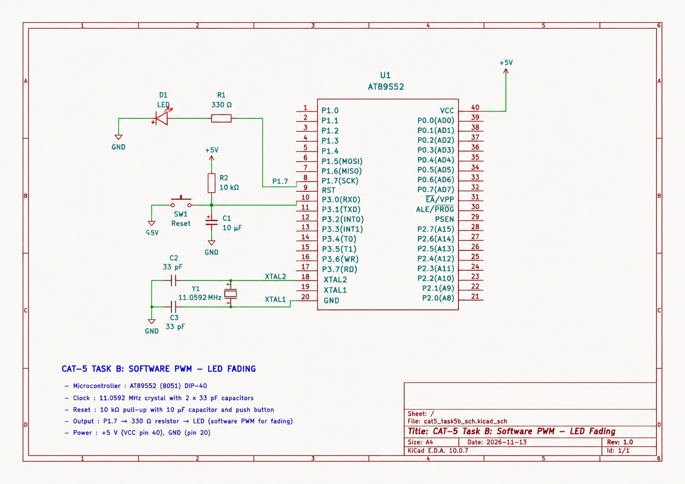

# EXPERIMENT DETAILS

**EXP:** CONTINUOUS LAB EVALUATION 5 – TIMER-BASED LED CONTROL

**DATE:** 10/08/2026

**NAME OF EXP:** Timer-Based Variable-Frequency and Waveform Pattern Generator

**HARDWARE SETUP / PLATFORM:** Keil µVision + AT89S52 Development Board + 11.0592 MHz Crystal

---

## TASK 2B – Variable-Frequency Signal and Waveform Generation

### 1. Circuit Diagram

The experiment uses the AT89S52 microcontroller to generate different digital signal patterns with selectable frequencies. Two push buttons are used to change the output frequency and waveform pattern.

**Hardware Components and Connections:**

- **Development Board:** AT89S52 8051 Development Board
- **Microcontroller IC:** AT89S52
- **CPU Core:** 8051
- **Operating Voltage:** +5 V
- **Crystal Oscillator:** 11.0592 MHz
- **Crystal Pins:** XTAL1 (Pin 19) and XTAL2 (Pin 18)
- **Signal Output:** P1.0 (Pin 1)
- **Frequency Selection Button:** P3.4 (Pin 14)
- **Waveform Selection Button:** P3.5 (Pin 15)
- **Power Supply:** +5 V and GND

The two push buttons are connected between their respective GPIO pins and GND. The pins are configured as inputs using the 8051 quasi-bidirectional port structure by writing logic HIGH to them.

**Circuit Diagram:**
 

### 2. Core Logic / Pseudocode / Code Base

**Working Principle:**

This experiment demonstrates digital signal generation using Timer0 interrupts and direct register-level programming on the AT89S52 microcontroller.

Timer0 is configured in Mode 2 (8-bit auto-reload mode) to generate periodic interrupts. The interrupt service routine controls the output signal on P1.0 according to the selected waveform pattern and frequency.

Two push buttons are used:

- **KEY_F (P3.4):** Changes the output frequency through five predefined timing settings.
- **KEY_S (P3.5):** Changes the waveform pattern through four available patterns.

The program supports four signal patterns:

1. Square Wave
2. Variable Duty-Cycle Wave
3. Pulse Train
4. Burst Signal

The selected waveform is stored in an array, and the interrupt routine updates the output pin by reading successive elements from that array.

Button scanning is performed periodically using a flag generated by the timer interrupt. Falling-edge detection identifies button presses and changes the selected frequency or waveform.

**Pseudocode:**

1. Initialize the signal output pin P1.0.
2. Configure P3.4 and P3.5 as button inputs.
3. Initialize the frequency and waveform selection variables.
4. Configure Timer0 in Mode 2.
5. Enable Timer0 and global interrupts.
6. Start Timer0.
7. In the Timer0 interrupt service routine:
   - Increment the signal timing counter.
   - When the selected timing interval is reached:
     - Reset the counter.
     - Update P1.0 using the selected waveform pattern.
     - Move to the next pattern element.
   - Increment the button scanning counter.
   - Set the scan flag after the required interval.
8. In the main loop:
   - Check the scan flag.
   - Read both push-button inputs.
   - Detect falling-edge button presses.
   - Update the frequency selection when KEY_F is pressed.
   - Update the waveform selection when KEY_S is pressed.
9. Continue generating the selected signal.

**Code Base:**

The implementation uses the following registers, variables and functions:

- `TMOD` – Configures Timer0 in Mode 2.
- `TH0` and `TL0` – Set the timer reload value.
- `ET0` – Enables the Timer0 interrupt.
- `EA` – Enables or disables global interrupts.
- `TR0` – Starts Timer0.
- `P1.0` – Digital signal output.
- `P3.4` – Frequency selection input.
- `P3.5` – Waveform selection input.
- `half_ticks[]` – Stores the available frequency timing settings.
- `pat_square[]` – Stores the square-wave pattern.
- `pat_vduty[]` – Stores the variable-duty-cycle pattern.
- `pat_pulse[]` – Stores the pulse-train pattern.
- `pat_burst[]` – Stores the burst-signal pattern.
- `load_pattern()` – Loads the selected waveform pattern.

The timer interrupt generates the signal and periodically requests button scanning. The main loop handles button inputs and updates the selected settings without using blocking software delay loops.

### 3. INFERENCE

The experiment demonstrates variable-frequency digital signal generation using Timer0 interrupts on the AT89S52 microcontroller.

Different output waveforms, including square wave, variable duty-cycle wave, pulse train and burst signal, can be selected using a push button. A second push button changes the signal timing and hence its output frequency.

This experiment demonstrates hardware timer configuration, interrupt-based signal generation, GPIO input handling, waveform selection and direct register-level programming.
