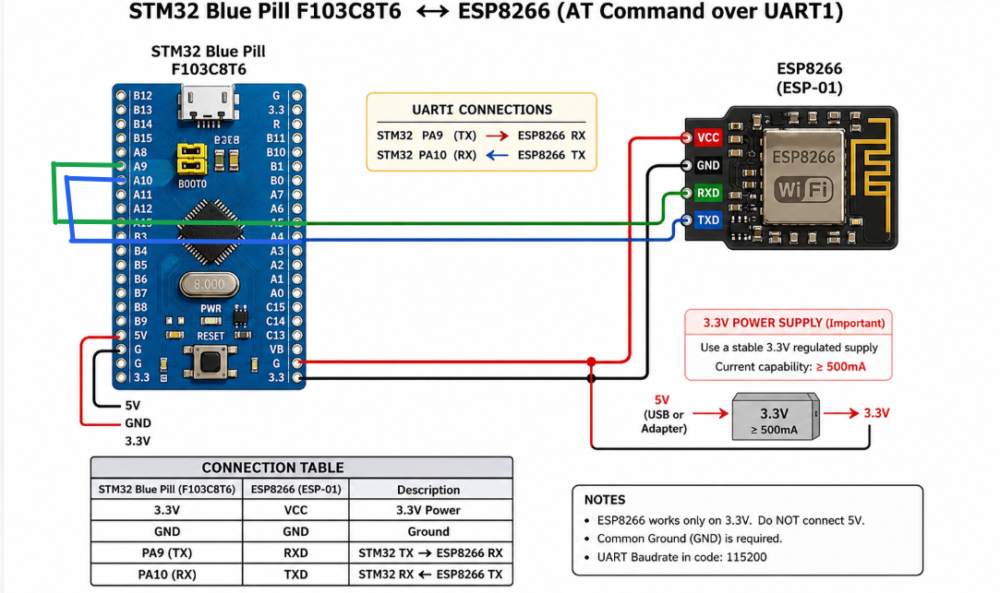

# EXPERIMENT DETAILS

**EXP:** CONTINUOUS LAB EVALUATION 10

**DATE:** 05/10/2026 (Week 9)

**NAME OF EXP:** STM32–Wemos Wi-Fi Modem Interface Using AT Commands

**HARDWARE SETUP / PLATFORM:** CubeMX + Keil MDK + STM32 Development Board (Blue Pill STM32F103C8T6) + Wemos D1 Mini (ESP8266)

---

## TASK 9A – Establish STM32 ↔ Wemos UART Communication

### 1. Circuit Diagram

The experiment establishes UART communication between the STM32 Blue Pill development board and the Wemos D1 Mini (ESP8266) module.

- **Development Board:** STM32 Blue Pill
- **Microcontroller IC:** STM32F103C8T6
- **Wi-Fi Module:** Wemos D1 Mini (ESP8266)
- **Communication Protocol:** UART
- **STM32 UART Peripheral:** USART1 (PA9 – TX, PA10 – RX)
- **PC Communication:** USART2

**Connections:**

| Wemos D1 Mini Pin | STM32 Pin | Description |
|---|---|---|
| TX | PA10 (USART1_RX) | Data from Wemos to STM32 |
| RX | PA9 (USART1_TX) | Data from STM32 to Wemos |
| GND | GND | Common Ground |
| 3.3V | 3.3V | Power Supply |

### 2. Core Logic / Pseudocode / Code Base

**Working Principle:**

The experiment demonstrates UART communication between the STM32 microcontroller and the Wemos D1 Mini Wi-Fi module using AT commands.

The STM32 transmits the `AT` command to the Wemos module through USART1. The Wemos processes the command and sends its response back through UART. The STM32 receives the response character by character using `HAL_UART_Receive()` and forwards the received data to the PC terminal through USART2.

Both USART1 and USART2 are configured with a baud rate of 115200, 8 data bits, 1 stop bit, and no parity.

**Pseudocode:**

1. Initialize the HAL library.
2. Configure the system clock.
3. Initialize GPIO, USART1 and USART2 peripherals.
4. Define the AT command as `AT\r\n`.
5. Transmit the AT command to the Wemos module through USART1.
6. Continuously check for incoming data from the Wemos using `HAL_UART_Receive()`.
7. If a character is received, transmit it to the PC terminal through USART2.
8. Repeat the process continuously.

**Code Base:**

The UART communication is implemented using the following STM32 HAL functions:

- `HAL_UART_Init()` – Initializes the UART peripherals.
- `HAL_UART_Transmit()` – Transmits the AT command to the Wemos and forwards received characters to the PC terminal.
- `HAL_UART_Receive()` – Receives response characters from the Wemos module.
- `HAL_Delay()` – Provides a delay wherever required.

**AT Command Used:**

`AT\r\n`

The command checks whether the Wemos ESP8266 module is responding correctly.

### 3. Inference

The STM32 successfully establishes UART communication with the Wemos D1 Mini using USART1. The AT command is transmitted to the ESP8266 module, and its response is received character by character and displayed on the PC terminal through USART2.

Thus, UART-based communication between STM32, Wemos D1 Mini and the PC terminal is demonstrated successfully.
