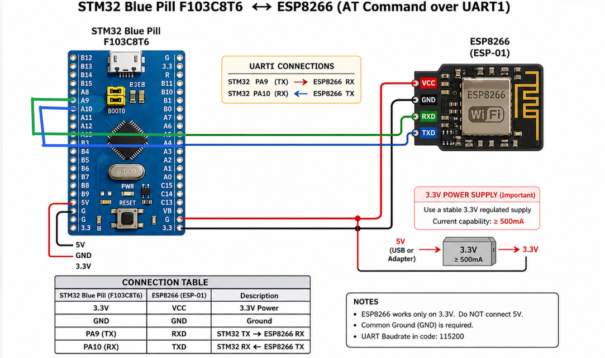

# EXPERIMENT DETAILS

**EXP:** CONTINUOUS LAB EVALUATION 10

**DATE:** 05/10/2026 (Week 9)

**NAME OF EXP:** Connect Wemos ESP8266 to Wi-Fi Using AT Commands

**HARDWARE SETUP / PLATFORM:** CubeMX + Keil MDK + STM32 Development Board (Blue Pill STM32F103C8T6) + Wemos D1 Mini (ESP8266)

---

## TASK 10B – Connect Wemos to Wi-Fi

### 1. Circuit Diagram

The experiment establishes UART communication between the STM32 Blue Pill development board and the Wemos D1 Mini (ESP8266) module to configure the Wi-Fi connection using AT commands.

- **Development Board:** STM32 Blue Pill
- **Microcontroller IC:** STM32F103C8T6
- **Wi-Fi Module:** Wemos D1 Mini (ESP8266)
- **Communication Protocol:** UART
- **STM32 UART Peripheral:** USART1 (PA9 – TX, PA10 – RX)
- **PC Communication:** USART2

**Connections:**

| Wemos D1 Mini Pin | STM32 Pin | Description |
|---|---|---|
| TX | PA10 (USART1_RX) | Data from Wemos to STM32 |
| RX | PA9 (USART1_TX) | Data from STM32 to Wemos |
| GND | GND | Common Ground |
| 3.3V | 3.3V | Power Supply |

### 2. Core Logic / Pseudocode / Code Base

**Working Principle:**

The experiment demonstrates how to configure the Wemos D1 Mini (ESP8266) as a Wi-Fi station and connect it to a Wi-Fi network using AT commands from the STM32 microcontroller.

The STM32 communicates with the ESP8266 through USART1. Initially, a 2-second delay is provided to allow the Wemos module to boot. The STM32 then transmits AT commands to check the module's response, configure it in station mode, connect it to the specified Wi-Fi network, and retrieve its IP address.

The responses received from the Wemos through USART1 are forwarded character by character to the PC terminal through USART2.

**AT Commands Used:**

1. `AT\r\n` – Checks whether the ESP8266 module is responding.
2. `AT+CWMODE=1\r\n` – Configures the ESP8266 in Wi-Fi station mode.
3. `AT+CWJAP="SNUC","snu12345"\r\n` – Connects the ESP8266 to the Wi-Fi network using the SSID and password.
4. `AT+CIFSR\r\n` – Retrieves the IP address assigned to the ESP8266.

**Pseudocode:**

1. Initialize the HAL library.
2. Configure the system clock.
3. Initialize GPIO, USART1 and USART2 peripherals.
4. Provide a 2-second delay for the Wemos module to boot.
5. Transmit the `AT` command and receive the response.
6. Send `AT+CWMODE=1` to configure Wi-Fi station mode.
7. Send `AT+CWJAP` with the Wi-Fi SSID and password to connect to the network.
8. Send `AT+CIFSR` to retrieve the assigned IP address.
9. Receive the responses from the Wemos through USART1.
10. Forward the received characters to the PC terminal through USART2.

**Code Base:**

The UART communication and Wi-Fi configuration are implemented using the following STM32 HAL functions:

- `HAL_UART_Init()` – Initializes the USART1 and USART2 peripherals.
- `HAL_UART_Transmit()` – Transmits AT commands to the ESP8266 module.
- `HAL_UART_Receive()` – Receives response characters from the ESP8266 module.
- `HAL_Delay()` – Provides a 2-second delay for the Wemos module to boot.
- `strlen()` – Determines the length of the AT command string.

A user-defined function `send(char *cmd, uint32_t timeout_ms)` is implemented to transmit AT commands through USART1, receive the responses, and forward them to the PC terminal through USART2.

### 3. Inference

The STM32 successfully communicates with the Wemos D1 Mini using UART and configures the ESP8266 in Wi-Fi station mode using AT commands. The module attempts to connect to the specified Wi-Fi network, and the `AT+CIFSR` command retrieves the assigned IP address.

The responses from the ESP8266 are displayed on the PC terminal, demonstrating UART-based Wi-Fi configuration and network connectivity using the STM32 microcontroller.
