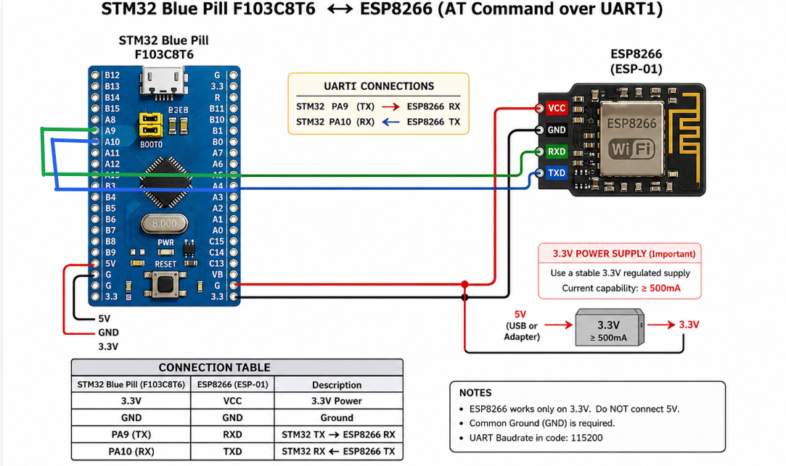

# EXPERIMENT DETAILS

**EXP:** CONTINUOUS LAB EVALUATION 11

**DATE:** 12/10/2026

**NAME OF EXP:** HTTP Server – STM32 and Wemos Wi-Fi Module Using AT Commands

**HARDWARE SETUP / PLATFORM:** STM32CubeMX + Keil MDK + STM32 Development Board Blue Pill STM32F103C8T6 + Wemos D1 Wi-Fi Module (ESP8266)

---

## TASK 11A – Configure ESP8266 as a TCP Server

### 1. Circuit Diagram

The experiment uses UART communication between the STM32 Blue Pill development board and the Wemos D1 Wi-Fi module (ESP8266) to configure the ESP8266 as a TCP server using AT commands.

- **Development Board:** STM32 Blue Pill
- **Microcontroller IC:** STM32F103C8T6
- **Wi-Fi Module:** Wemos D1 (ESP8266)
- **UART Peripherals:** USART1 and USART2
- **Communication Interface:** UART Serial Communication
- **Baud Rate:** 115200 bps
- **TCP Server Port:** 80

**Connections:**

- STM32 USART1 TX (PA9) → ESP8266 RX
- STM32 USART1 RX (PA10) → ESP8266 TX
- STM32 USART2 is used for displaying ESP8266 responses on the PC terminal.
- Common GND is connected between STM32 and ESP8266.

### 2. Core Logic / Pseudocode / Code Base

**Working Principle:**

The experiment demonstrates communication between the STM32 Blue Pill and the ESP8266 Wi-Fi module using UART AT commands.

USART1 is configured to communicate with the ESP8266, while USART2 is used to display the received responses on the PC terminal. Both UART peripherals are configured with a baud rate of 115200, 8 data bits, no parity, and 1 stop bit.

A custom `send()` function transmits AT commands to the ESP8266 using `HAL_UART_Transmit()` and receives its responses using `HAL_UART_Receive()`. The received response characters are forwarded to the PC terminal through USART2.

The following AT commands are executed:

- **AT:** Checks whether the ESP8266 module is responding.
- **AT+CWMODE=1:** Configures the ESP8266 in Station Mode.
- **AT+CWJAP="SNUC","snu12345":** Connects the ESP8266 to the Wi-Fi network using the specified SSID and password.
- **AT+CIFSR:** Retrieves the IP address of the ESP8266.
- **AT+CIPSTATUS:** Checks the current connection status.
- **AT+CIPMUX=1:** Enables multiple TCP connections.
- **AT+CIPSERVER=1,80:** Starts the TCP server on port 80.

A delay of 2 seconds is provided initially to allow the ESP8266 module to boot before sending the AT commands. Appropriate delays are also provided for receiving responses from the module.

**Pseudocode:**

1. Initialize the HAL library.
2. Configure the system clock.
3. Initialize GPIO, USART1, and USART2 peripherals.
4. Configure both UART peripherals with 115200 baud rate and 8N1 configuration.
5. Wait for 2 seconds for the ESP8266 module to boot.
6. Send the `AT` command to check module communication.
7. Send `AT+CWMODE=1` to configure Station Mode.
8. Send `AT+CWJAP` to connect to the Wi-Fi network.
9. Send `AT+CIFSR` to obtain the IP address.
10. Send `AT+CIPSTATUS` to check the connection status.
11. Send `AT+CIPMUX=1` to enable multiple connections.
12. Send `AT+CIPSERVER=1,80` to start the TCP server on port 80.
13. Receive the ESP8266 responses through USART1.
14. Forward the received responses to the PC terminal through USART2.
15. Keep the STM32 running to maintain the configured server.

**Code Base:**

The experiment uses the following STM32 HAL functions and standard C library functions:

- `HAL_UART_Init()` – Initializes USART1 and USART2 peripherals.
- `HAL_UART_Transmit()` – Transmits AT commands to the ESP8266.
- `HAL_UART_Receive()` – Receives responses from the ESP8266.
- `HAL_Delay()` – Provides delays for module initialization and command execution.
- `strlen()` – Calculates the length of the AT command strings.

The custom `send()` function is used to transmit AT commands to the ESP8266 and forward its responses to the PC terminal.

### 3. Inference

The STM32 Blue Pill successfully communicates with the ESP8266 Wi-Fi module using UART AT commands. The ESP8266 is configured in Station Mode, connected to the specified Wi-Fi network, and assigned an IP address. Multiple connections are enabled, and a TCP server is successfully configured on port 80.

Thus, the experiment demonstrates UART-based Wi-Fi module configuration, AT command communication, Wi-Fi connectivity, and TCP server initialization using STM32 HAL libraries.
