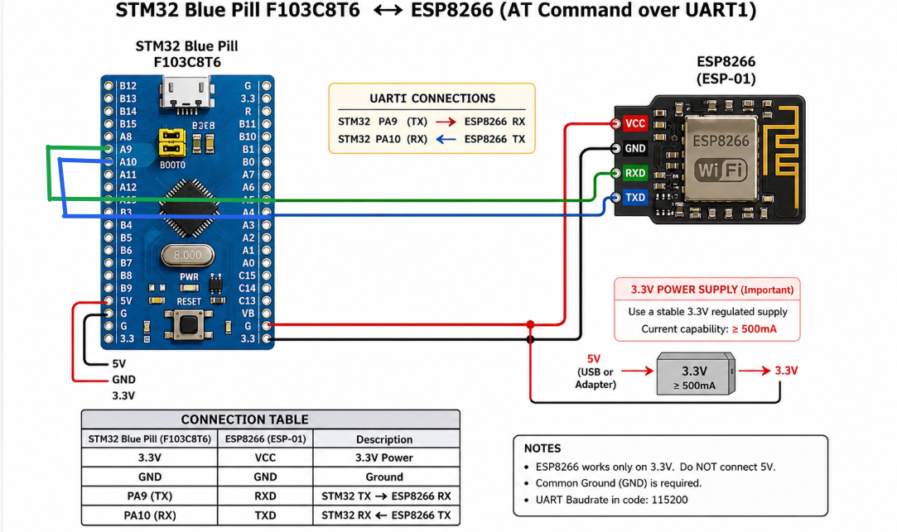

# EXPERIMENT DETAILS

**EXP:** CONTINUOUS LAB EVALUATION 11

**DATE:** 12/10/2026

**NAME OF EXP:** STM32-Based HTTP Server Using ESP8266 Wi-Fi Module

**HARDWARE SETUP / PLATFORM:** STM32CubeMX + Keil MDK + STM32 Development Board Blue Pill STM32F103C8T6 + Wemos D1 Wi-Fi Module (ESP8266)

---

## TASK 11B – Observe HTTP Request and Construct HTTP Response

### 1. Circuit Diagram

The experiment uses UART communication between the STM32 Blue Pill development board and the ESP8266 Wi-Fi module to receive HTTP requests from a browser and transmit HTTP responses.

- **Development Board:** STM32 Blue Pill
- **Microcontroller IC:** STM32F103C8T6
- **Wi-Fi Module:** Wemos D1 (ESP8266)
- **UART Peripherals:** USART1 and USART2
- **UART Communication:** USART1 for ESP8266 communication
- **UART Communication:** USART2 for PC terminal monitoring
- **Baud Rate:** 115200 bps
- **TCP Server Port:** 80
- **Communication Protocol:** HTTP over TCP

The STM32 USART1 TX pin (PA9) is connected to the ESP8266 RX pin, and USART1 RX (PA10) is connected to the ESP8266 TX pin. USART2 is used to display incoming requests and ESP8266 responses on the PC terminal. All devices share a common GND connection.

### 2. Core Logic / Pseudocode / Code Base

**Working Principle:**

The experiment demonstrates HTTP request handling and response generation using the STM32 Blue Pill and ESP8266 Wi-Fi module.

The ESP8266 is configured as a TCP server on port 80 using AT commands. When a browser sends an HTTP request, the ESP8266 generates a `+IPD` notification containing the received network data.

The STM32 receives this data through USART1 using `HAL_UART_Receive()` and forwards it to the PC terminal through USART2 for debugging.

The `http_server()` function collects the incoming `+IPD` header until the colon (`:`) is detected. It extracts the connection ID and data length using `atoi()`, `strchr()`, and `strstr()`. The HTTP request payload is then read and displayed on the PC terminal.

After receiving the request, the STM32 constructs an HTTP response containing the status line, headers, and response body.

The following operations are performed:

- **HTTP Request Reception:** Receives browser requests through the ESP8266 `+IPD` notification.
- **Header Processing:** Extracts the connection ID and received data length.
- **HTTP Response Construction:** Creates an HTTP response with status code `200 OK`, content type, content length, and response body.
- **Response Transmission:** Sends the `AT+CIPSEND` command to specify the connection ID and response length. After receiving the `>` prompt, the STM32 transmits the HTTP response.
- **Connection Closure:** Uses `AT+CIPCLOSE` to close the browser connection after sending the response.

The response body defined in the code is `Dr.Dinesh is GREAT!!!`.

**Pseudocode:**

1. Initialize the HAL library.
2. Configure the system clock.
3. Initialize GPIO, USART1, and USART2 peripherals.
4. Configure both UART peripherals with 115200 baud rate and 8N1 configuration.
5. Wait for 2 seconds to allow the ESP8266 module to boot.
6. Configure the ESP8266 using the following AT commands:
   - `AT`
   - `AT+CWMODE=1`
   - `AT+CWJAP="SNUC","snu12345"`
   - `AT+CIFSR`
   - `AT+CIPSTATUS`
   - `AT+CIPMUX=1`
   - `AT+CIPSERVER=1,80`
7. Enter the `http_server()` function.
8. Receive incoming data from the ESP8266 through USART1.
9. Forward the received data to the PC terminal through USART2.
10. Collect the `+IPD` header until the colon is detected.
11. Extract the connection ID and HTTP request data length.
12. Read the HTTP request payload.
13. Construct an HTTP response containing:
    - HTTP status line: `HTTP/1.1 200 OK`
    - Content type: `text/plain`
    - Content length
    - Response body
14. Send the `AT+CIPSEND` command with the connection ID and response length.
15. Wait for the `>` prompt from the ESP8266.
16. Transmit the HTTP response to the browser.
17. Introduce a delay of 500 ms.
18. Send `AT+CIPCLOSE` to close the connection.
19. Repeat the process continuously to handle further browser requests.

**Code Base:**

The experiment uses the following STM32 HAL functions and standard C library functions:

- `HAL_UART_Init()` – Initializes USART1 and USART2 peripherals.
- `HAL_UART_Transmit()` – Transmits AT commands and HTTP responses.
- `HAL_UART_Receive()` – Receives HTTP request data and ESP8266 responses.
- `HAL_Delay()` – Introduces delays during module initialization and connection handling.
- `snprintf()` – Constructs AT commands dynamically.
- `strlen()` – Calculates the length of commands and HTTP responses.
- `strstr()` – Searches for the `+IPD` notification.
- `strchr()` – Locates the comma in the received `+IPD` header.
- `atoi()` – Converts connection ID and data length strings into integers.

The custom functions `send()` and `http_server()` are used for AT command communication, HTTP request reception, response generation, and transmission.

### 3. Inference

The STM32 Blue Pill successfully receives HTTP requests from a browser through the ESP8266 Wi-Fi module. The incoming `+IPD` notification is processed to extract the connection ID and request length. The STM32 constructs an HTTP response with status code `200 OK` and transmits it to the browser using the `AT+CIPSEND` command.

Thus, the experiment demonstrates HTTP request reception, TCP connection handling, HTTP response construction, and browser communication using the STM32 HAL library and ESP8266 AT commands.
